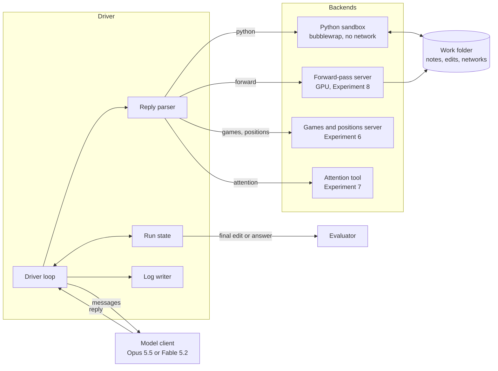
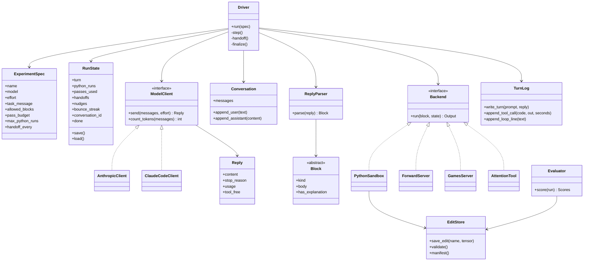
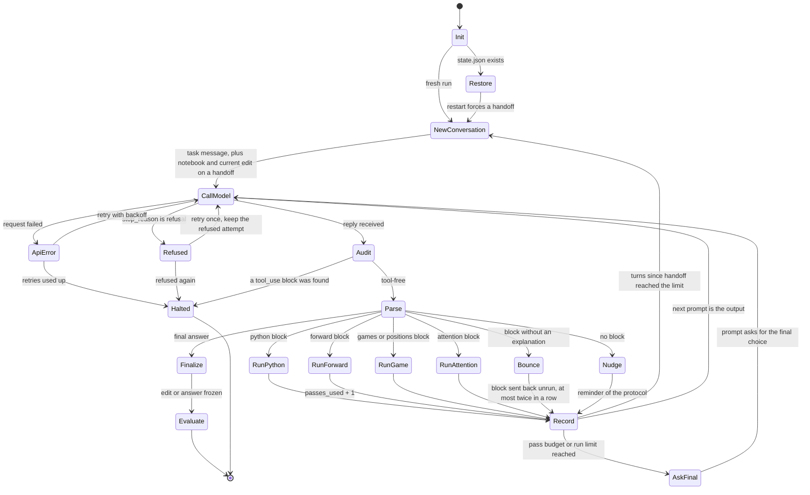
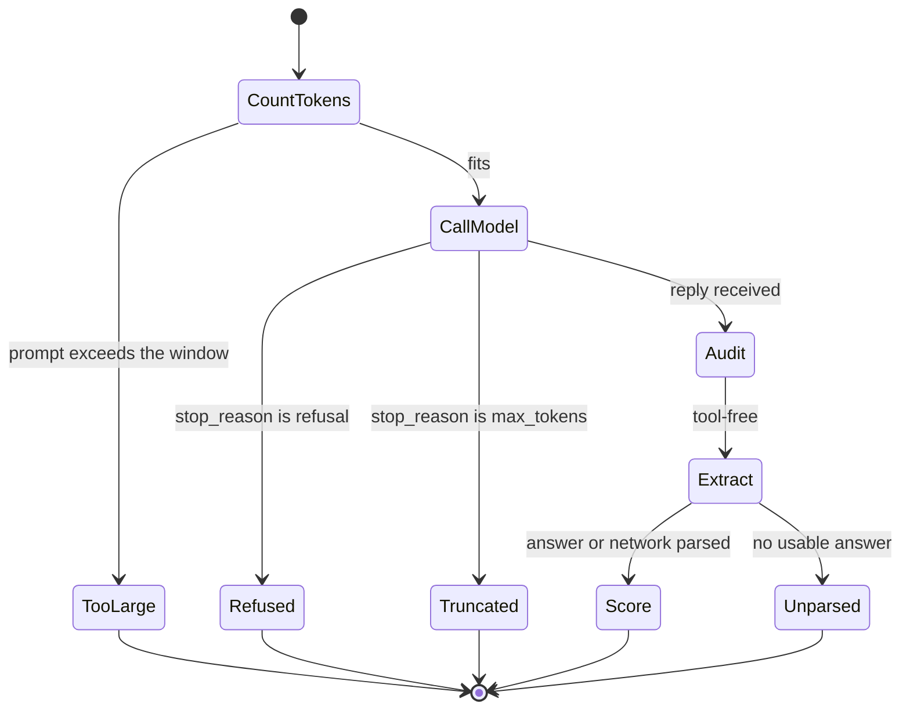
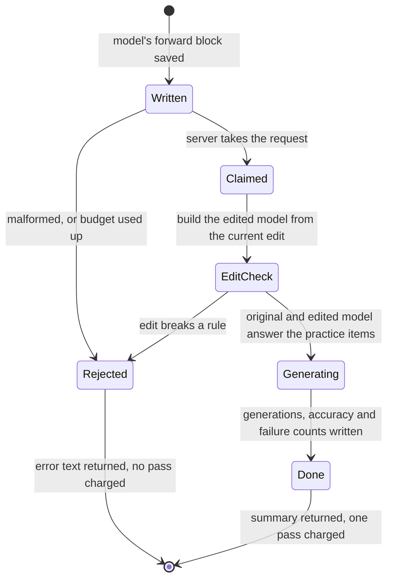
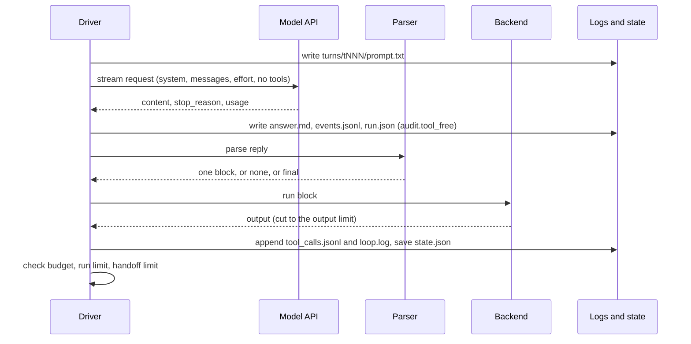

# Plan: reproducing the Weight-Space Programming experiments with Claude Opus 5.5 and Claude Fable 5.2

The original experiments (in `rikiya's_exps/`) ran OpenAI's `gpt-6-astra` through the Codex CLI with every tool
off. This plan describes what is needed to run the same eight experiments with `claude-opus-5-5` and
`claude-fable-5-2`, and how the replacement harness should behave.

Status: plan only. Nothing here has been built or run.

## 1. Goal and ground rules

- **Same inputs.** Send the released prompts verbatim: each `prompt.txt` / `message.txt`, and the one-line system
  instruction in `rikiya's_exps/harness/instructions.md` ("Answer the user's request.").
- **Same rule for the model.** The model gets no tools. It replies with text that holds at most one fenced block,
  the harness runs that block, and the output is sent back as the next user message.
- **Same log layout.** Write `prompt.txt`, `answer.md`, `events.jsonl` and `run.json` per turn, in the layout
  described in `CLAUDE.md`, so the original audit and scoring scripts work on the new runs.
- **Staged runs, to control cost.** Most original conditions are a single run, and the target here is 3 per model
  and condition. Get there in stages:
  - **Stage 1:** one run per model and condition. Record the cost of every run.
  - **Stage 2:** add runs only where they matter: the result is close to Astra's or to the other model's, or the
    run ended in a refusal or a harness failure.
  - With one run, a difference between models cannot be told apart from run-to-run spread. Say so wherever a
    one-run result is reported.
  - Report every run, including failed ones.

## 2. What we have and what is missing

| Piece | In the repo? | Needed for |
|---|---|---|
| Prompts and system instruction | Yes, verbatim | All |
| Networks shown to the model, answer keys | Yes (`networks/`, `eval/`) | 1, 2, 4, 5 |
| Codex config, Experiment 6 sandbox (`harness/sandbox.py`) | Yes | Reference only |
| Driver loop (turns, limits, handoffs, restarts) | **No** | 3, 6, 7, 8 |
| Reply parser and edit-language reader | **No** | 3, 6, 7, 8 |
| Sandboxes and preludes for Experiments 3 and 8 | **No** (Experiment 7's prelude is included) | 3, 8 |
| Forward-pass server (Qwen, Gemma) | **No** | 8 |
| Games and positions server, hidden PPO opponents | **No** | 6 |
| Attention tool | **No** | 7 |
| Scorers for Experiments 1, 2, 4, 5 | **No** (keys are included) | 1, 2, 4, 5 |
| Full networks for Experiment 3's ground truth | **No** | 3 |
| Experiment 7 fine-tunes | **No** (training code included, GPU needed, not bit-identical) | 7 |
| Experiment 8 eval pipeline | Partly (`apply_edit.py`, `merge.py`; vLLM settings in the README) | 8 |

Infrastructure needed:

- An Anthropic API key with access to both models. Fable 5.2 needs 30-day data retention on the organization.
- Python 3.10+ with the `anthropic` SDK and numpy.
- A Linux machine or WSL for the bubblewrap sandbox (this checkout is on Windows).
- A GPU for Experiment 8 (forward passes and vLLM evals) and Experiment 7 (rebuilding the fine-tunes).
- The public base weights for Experiment 8, at the revisions given in `rikiya's_exps/exp8_math/README.md`.

### 2.1 Reconstruction method for the missing pieces

The released logs record most of what the missing harness did. Rebuild each piece from them, not from guesses:

| Missing piece | Where its behaviour is recorded |
|---|---|
| Rules given to the model | The first prompt of each run (`turns/t001/prompt.txt`, `message.txt`) |
| Harness wording: nudges, bounces, handoffs, the request for a final answer | The later `turns/tNNN/prompt.txt` files, verbatim |
| Limits and counters | `state.json` and `loop.log` |
| Sandbox behaviour: prelude names, output cut-off, time limit | `tool_calls.jsonl` (`code`, `out`, `s` for every run) and each experiment's README |
| Forward-pass request and result format | `requests/fwd_<k>.json.claimed` and `fwd_<k>.done.json` |

- **Acceptance test.** Replay Astra's recorded answers through the new parser and backends. The rebuilt harness
  passes when, on every turn, it picks the same block, writes the same `loop.log` event, and produces the same
  output wherever the code is deterministic. Run this before spending anything on Claude calls.
- **What cannot be recovered.** Experiment 6's PPO opponents, Experiment 3's full networks and Experiment 7's
  fine-tunes have to be retrained. They will not match the originals; list them as known differences in any
  result.
- **Ask the authors.** They say a harness is in the works. Their code would beat any reconstruction, so ask for
  it before building.

## 3. What changes in the model call

| Original (Codex + Astra) | Replacement (Messages API) |
|---|---|
| `codex exec`, prompt on stdin | One streamed Messages request, no `tools` field |
| `codex exec resume <thread>` | Resend the full message list; the harness owns the history |
| `model_reasoning_effort` high / xhigh / max | `output_config.effort`, same level names. Set it on every call: Opus 5.5 defaults to `medium` |
| Reasoning summaries in `events.jsonl` | `thinking: {type: "adaptive", display: "summarized"}` |
| `model_context_window=872000` | 1M window on both models; no setting needed |
| Auto-compaction set above the window (never fired) | Do not enable compaction or context editing |
| Tool-free audit from the event stream | No `tool_use` block in the response; record as `audit.tool_free` |
| Codex thread ID | A harness-made conversation ID |

Other points for the client:

- **Token counts.** The tokenizer differs from Astra's. Count every prompt with the `count_tokens` endpoint before
  running. Experiment 4's prompt was 355k tokens for Astra and is the one most at risk.
- **Output size.** Stream every request and set `max_tokens` high (up to 128k). Experiment 5 replies contain whole
  networks.
- **History.** Keep it append-only and pass assistant content back unchanged, thinking blocks included. Fable 5.2
  rejects edited history.
- **Sampling.** `temperature`, `top_p` and `top_k` cannot be set on either model. Runs differ by sampling, as the
  original ones did.
- **Refusals.** Check `stop_reason` before reading the content. Log a `refusal` as an outcome, as the original did
  (`exp8_math/runs/p50c/refused/`). Do not enable model fallbacks: they would swap the model under test.
- **Caching.** Turn on prompt caching for multi-turn runs. It changes cost only, not behaviour.
- **Usage.** Record each response's `usage` per turn. Unlike Codex's counts, these are per request, not cumulative.

### 3.1 Alternative client: Claude Code in headless mode

The authors ran Astra through OpenAI's own harness (`codex exec`). The matching choice for Claude is Claude Code
in headless mode (`claude -p`) with every tool off.

| | Messages API | Claude Code headless |
|---|---|---|
| What the model sees | Exactly the system line and prompt we send | Our prompt plus whatever Claude Code adds, unless stripped (`--system-prompt`, `--bare`, tools disabled) |
| History | The harness owns it | Claude Code owns it (`--resume`) and may compact it |
| Controls | Effort, `max_tokens` and thinking display are explicit | `--effort` exists; the output cap and thinking display are less direct |
| Logs | The raw response per turn | `--output-format stream-json`, closer to the original `events.jsonl` |
| Cost | Per token | Can run on a Claude subscription, within its usage limits |

Decision:

- **Primary client: the Messages API**, because nothing hidden reaches the model.
- **Second client: `ClaudeCodeClient`**, behind the same `ModelClient` interface. It is the cheaper route on a
  subscription. Before using it, dump what it actually sends with everything stripped and check for added
  context. This check has not been done.
- Runs through Claude Code are a separate condition. Do not pool them with Messages API runs.

## 4. Harness design

### 4.1 Components

### 4.2 Classes

`ModelClient` is an interface so the same driver can run Opus or Fable through either client (section 3.1), or a replay of Astra's recorded answers.
Replaying the recorded answers through the new parser and backends is the main test of the rebuilt harness.

### 4.3 State machine: multi-turn run (Experiments 3, 6, 7, 8)

The states and limits follow what the original logs show: `loop.log` lines such as `python`, `forward`, `games`,
`positions`, `no block`, `python block without an explanation`, `final`, `new thread` and `resume`, and the counters
in `state.json` (`runs`, `passes`, `nudges`, `handoffs`, `since_handoff`, `flag_streak`).

Notes on the states:

- **Record** writes the turn folder, appends to `tool_calls.jsonl` and `loop.log`, and saves `state.json` before
  anything else happens. A restart then resumes from the last saved turn and reuses any recorded answer.
- **Bounce** applies to Experiment 8, where each block must come with an explanation. After two bounces in a row
  the block is run anyway.
- **NewConversation** on a handoff starts an empty message list. Its first message carries the task text, the
  model's notebook from the work folder, and the current edit. Experiment 8 used a limit of 40 turns.
- **Halted** keeps all files. A halted run is reported, not deleted.

### 4.4 State machine: single-reply run (Experiments 1, 2, 4, 5)

Every end state is a recorded outcome. Do not re-roll a run because its answer was wrong or unparsed.

### 4.5 State machine: one forward-pass request (Experiment 8)

The original logs show each request as `requests/fwd_<k>.json.claimed`, then `fwd_<k>.done.json`.

The edit rules to enforce are in `rikiya's_exps/exp8_math/README.md`: no edits to the final norm or the embedding
and output layer, and no edit that only multiplies a whole tensor by a constant.

### 4.6 Sequence: one turn

## 5. Per-experiment work

The Effort column copies the level the authors used for Astra in each experiment (see each experiment's README).
Each experiment runs at that one level; there is no effort sweep. The same level name does not mean the same
amount of reasoning across vendors, so record thinking tokens per run and report them next to Astra's. A cheaper
level, such as `high` on Experiment 8, is a separate, labelled condition.

| Experiment | Effort | Harness needed | Extra work | Comparable with the post? |
|---|---|---|---|---|
| 1 Which game | high | Single-reply | Scorer from the answer key | Yes |
| 2 Diffusion | high | Single-reply | Scorer from the answer key | Yes |
| 4 Fix the car | high | Single-reply | Apply the edit, run the car environment | Yes, once the environment is rebuilt |
| 5 Write from scratch | xhigh | Single-reply | MinAtar evaluation of the written network | Yes |
| 3 Language | xhigh | Multi-turn, Python only | Rebuild the sandbox; train or obtain the full networks | Partly: the model's answers yes, the head-level ground truth no |
| 6 Go | xhigh | Multi-turn, Python and games | Games server; new PPO opponents | Partly: same-size PPO head-to-heads only |
| 7 Sycophancy | xhigh | Multi-turn, Python and attention | Retrain the fine-tunes; attention tool | Weakly: the models differ |
| 8 Math | max | Multi-turn, Python and forward | Forward server, edit checks, vLLM evals | Yes, with the same base revision and eval settings |

## 6. Order of work

1. **Model client and log writer.** Check the output against the original `run.json` layout with the audit
   one-liner in `CLAUDE.md`.
2. **Experiments 1, 2, 4, 5.** Count tokens first. These are single calls and cost a few dollars per run. Do one
   run per model (stage 1 in section 1) and use the measured cost to budget everything after.
3. **Driver, parser and Python sandbox.** Build them by the method in section 2.1 and pass its acceptance test
   before any multi-turn Claude call.
4. **Experiment 3**, then **Experiment 6**.
5. **Experiment 8.** Start with the 10-pass budget to check the forward server and evals, then run 25 and 50.
6. **Experiment 7** last: it needs the most rebuilding and gives the weakest comparison.

## 7. Risks and open questions

- **Classifier refusals.** Astra's own run hit one content-filter refusal (p50c, turn 6). Fable 5.2 and Opus 5.5
  have their own classifiers, and Experiment 8 asks the model to edit a language model's weights. Whether that
  triggers a refusal is unknown until tried.
- **Prompt fit.** The Experiment 8 prompt went through at least five versions for Astra. Reusing it favours Astra.
  Any reworded prompt must be reported as a separate condition.
- **Token budget.** If a prompt does not fit in 1M tokens with the Claude tokenizer, that experiment cannot be run
  as specified. Report it; do not shorten the network text.
- **Cost of long runs.** Astra's 50-pass run took 158 turns and about 20 hours. At effort `max` on Fable 5.2 the
  cost is unknown; measure it on the 10-pass run first.
- **Rebuilt-harness differences.** Our sandbox limits, output cut-offs and nudge texts will not match the
  originals exactly. Take them from the recorded prompts wherever they appear there.
- **Small samples.** With a few runs per condition, differences between models smaller than the run-to-run spread
  cannot be claimed.
