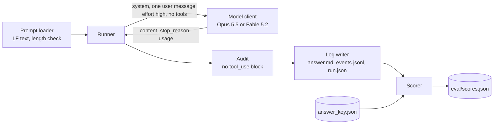

# Plan: Experiment 1 ("which game?") with Claude Opus 5.5 and Claude Fable 5.2

This is the detailed plan for the first experiment in `reproduce_fable_opus_plan.md`. The original is in
`rikiya's_exps/exp1_which_game/`; its `README.md` is the authority on what was run.

Status: plan only. Nothing here has been built or run.

## 1. The original experiment

- **Question.** Given only the weights of a policy network, which game was it trained on? No list of games is
  given.
- **Networks.** Four PPO policies (Breakout, Pong, Pac-Man, Freeway), each a 500 → 32 → 32 → 5 tanh MLP with
  17,253 weights. Only these four were released.
- **Call.** One fresh conversation per network, one reply, no tools, reasoning effort `high`.
- **Prompt.** `runs/<game>/prompt.txt`: the description, the question with a fixed answer format, and all the
  weights as text rounded to 3 decimals. About 115k characters, 73.7k tokens for Astra.
- **Astra's result.** 4 / 4 correct, with stated confidence 96–99 %. Each reply used about 1,700–1,850 output
  tokens and took 71–107 seconds.

## 2. What we run

| Setting | Value |
|---|---|
| Models | `claude-opus-5-5`, `claude-fable-5-2` |
| Networks | `a9f535cc`, `dfc6cb65`, `bdf99279`, `0bbcc3ea` |
| Runs in stage 1 | 1 per model and network: 8 calls |
| Effort | `high`, the level the authors used |
| Tools | None |
| Conversation | New for every call; no history |

Stage 2 follows the rule in the main plan: add runs only where a network was missed, refused, cut off or
unparsed. If both models get 4 / 4, stop; more runs would not separate them from Astra.

## 3. The request

One streamed Messages API request per run:

| Field | Value |
|---|---|
| `model` | The model ID |
| `system` | `Answer the user's request.` (the text of `runs/<game>/instructions.md`, without the line ending) |
| `messages` | One user message: the prompt text, unchanged |
| `tools` | Not sent |
| `output_config.effort` | `high` (set it explicitly; Opus 5.5 defaults to `medium`) |
| `thinking` | `{type: "adaptive", display: "summarized"}` |
| `max_tokens` | 64,000 |

Not used: sampling parameters (they cannot be set), prompt caching (single calls with different prompts),
fallback models, and compaction.

**Line endings.** This Windows checkout has `core.autocrlf=true`, so `prompt.txt` on disk has CRLF line endings
and is 615 characters longer than what Astra received. Read the prompt from git (`git show HEAD:<path>`) or
convert CRLF to LF, then check the length against the original `runs/loop.log`:

| Network | Characters sent to Astra |
|---|---|
| `a9f535cc` | 115,478 |
| `dfc6cb65` | 115,269 |
| `bdf99279` | 115,394 |
| `0bbcc3ea` | 115,259 |

The run must stop if a length does not match.

## 4. Harness

Experiment 1 needs only the small end of the harness in the main plan (section 4): one call in, one reply out.
There is no driver loop, no reply parser, no sandbox and no backend, because the model runs nothing and there is
no second turn. The original was the same: its `loop.log` shows only "asking" and "done" per network.



| Part | Does | Reused later |
|---|---|---|
| Prompt loader | Reads the released prompt with LF endings and checks its length (section 3) | Experiments 2, 4, 5 |
| Model client | Sends one streamed request and returns content, `stop_reason` and `usage`. This is `ModelClient` / `AnthropicClient` in the main plan | All experiments |
| Audit | Sets `audit.tool_free` | All experiments |
| Log writer | Writes the run folder (section 6). This is `TurnLog` in the main plan | All experiments |
| Runner | Walks the single-reply state machine (main plan, section 4.4) for each model and network | Experiments 2, 4, 5 |
| Scorer | Maps the `Game` line to a game and compares it with the key (section 7) | Experiment 1 only |

The model client, audit and log writer are written as modules, not inside the Experiment 1 script, so the
multi-turn driver can use them unchanged.

## 5. Steps

1. **Set-up.** Install the `anthropic` SDK (it is not installed; Python 3.13 is). Set `ANTHROPIC_API_KEY` (it is
   not set in this shell). Confirm the organization has 30-day data retention, which Fable 5.2 needs.
2. **Scorer first.** Write `score_exp1.py` and test it on Astra's four answers (section 7) before any Claude call.
3. **Count tokens.** Call `count_tokens` for the four prompts on both models. It is free. Write the counts down
   and work out the cost from them (section 8).
4. **Runner.** Write `run_exp1.py`: load the prompt, check its length, send the request, write the logs.
5. **One call.** Run one network on Opus 5.5. Check the log files and the cost against the estimate.
6. **The other seven calls.**
7. **Score and report** (section 9).

Everything runs on this Windows machine. Experiment 1 needs no sandbox and no GPU.

## 6. Logs and reproducibility

Everything for this experiment lives in `test-claude/exp01/`, so the original release stays untouched. The
folder's `README.md` describes the layout for anyone who opens it without this plan.

```
test-claude/exp01/
  README.md
  exp01_which_game_plan.md   the plan
  WRITEUP.md            results and reproducibility
  requirements.txt      pinned versions of the anthropic SDK and anything else used
  code/                 run_exp1.py, score_exp1.py
  runs/
    index.jsonl         one line per call ever made, appended and never edited
    loop.log            one line per call started and finished
    <model>/<network id>/run1/
      prompt.txt        the text sent (LF line endings)
      instructions.md   the system line
      request.json      the full request body, minus the prompt text (it points to prompt.txt)
      events.jsonl      the raw stream events, thinking summaries included
      answer.md         the reply text
      run.json          the run record
      stderr.log        runner errors, empty when there are none
  eval/
    token_counts.json   count_tokens results per model and network
    scores.json         the scorer's output
```

The modules shared with later experiments (model client, audit, log writer) go in `test-claude/common/`.

Folders are named by network ID, as in the original harness, so the game name appears nowhere in the run inputs.

**What `run.json` records.** It keeps the original keys where they still mean something (`ok`, `wall_s`,
`attempt`, `end`, `audit.tool_free`, `audit.usage`), so the audit one-liner in `CLAUDE.md` works on the new
folder. `audit.tool_free` is true when the response has no `tool_use` block. It adds what someone needs to repeat
or check the call:

| Key | Content |
|---|---|
| `model_requested`, `model_returned` | The ID we sent and the ID the API reported back |
| `effort`, `max_tokens`, `thinking` | The request settings |
| `message_id`, `request_id` | The API's identifiers for the response |
| `stop_reason`, `outcome` | The API's stop reason and our outcome (`ok`, `refused`, `truncated`, `unparsed`) |
| `prompt_sha256`, `prompt_chars` | A hash and length of the exact text sent |
| `start`, `end` | Timestamps with time zone |
| `sdk_version`, `python_version`, `code_commit` | The SDK, Python and the git commit of the runner |
| `cost_usd` | Worked out from `usage` and the prices in section 8 |

**Rules that keep the record honest.**

- **Nothing is overwritten.** A second run of the same model and network goes in `run2`. The runner refuses to
  write into a folder that exists.
- **Nothing is dropped.** Refused, cut-off and unparsed runs keep their folders and their line in `index.jsonl`.
  A request that failed before a reply (network or server error) is retried; each attempt is logged and counted
  in `attempt`.
- **No secrets.** The API key is read from the environment and never written. Check the logs for it before each
  commit.
- **Commit order.** Commit the code before running, so `code_commit` names code that exists. Commit the logs
  right after each batch of runs.
- **Scores come only from the logs.** `score_exp1.py` reads `answer.md` files and the answer key, calls nothing,
  and gives the same `scores.json` every time.

**What can and cannot be reproduced.**

- **Can:** anyone can re-check every number from the logs, re-run the scorer, and send the identical request
  again (same prompt hash, same settings).
- **Cannot:** get the same reply text. Sampling cannot be fixed on these models, and there is no seed. The same
  was true of the original Astra runs.
- **Unknown:** whether a model ID keeps pointing to the same weights over time. `model_returned` and the date are
  recorded for that reason.
- **Reasoning:** only thinking summaries are available, as with Astra's reasoning summaries. The full reasoning
  is not logged because the API does not return it.

## 7. Scoring

The original scorer was not released. The README gives its rule: the answer's `Game:` line is mapped to a game by
keywords, and Frogger counts as Freeway.

- **Find the answer.** Take the text after `Game:` or under a `Game` heading. Astra's replies use `## Game`
  headings, so both forms must work. Do the same for `Confidence`.
- **Map to a game.**

  | Game | Keywords (case-insensitive) |
  |---|---|
  | breakout | breakout, brick |
  | pong | pong |
  | pacman | pac-man, pacman, pac man |
  | freeway | freeway, frogger |

- **More than one game named.** The first game named in the `Game` text counts. An answer with no keyword is
  `unparsed` and scored wrong. These two rules are my choices; they are fixed here, before any run.
- **Test.** Run the scorer on `rikiya's_exps/exp1_which_game/runs/*/answer.md`. It must reproduce `guess`,
  `correct`, `answer_line` and `confidence` in the original `eval/scores.json` for all four.
- **Manual check.** Read all eight answers by hand as well, and report any where the keyword match and a human
  reading disagree.
- **Answer key.** Only the scorer reads `eval/answer_key.json`.

`scores.json` uses the original fields: `id`, `true`, `seed`, `mode`, `guess`, `correct`, `answer_line`,
`confidence`, `reasoning_summary`, `tool_free`, `usage`, `wall_s`, plus `model`.

## 8. Cost

These are estimates. Step 3 replaces them with measured token counts.

- **Input.** Astra's tokenizer gave 73.7k tokens per prompt. Claude's will differ; assume 75k–130k.
- **Output.** Astra used under 2k tokens. Claude's thinking at `high` may use far more; assume up to 20k.

| Model | Price per million (input / output) | Estimate per run | 4 runs |
|---|---|---|---|
| Opus 5.5 | $4 / $20 | $0.30–0.90 | $1.20–3.60 |
| Fable 5.2 | $8 / $40 | $0.60–1.80 | $2.40–7.20 |

Stage 1 should cost about $4–11. Stop and review if the first call (step 5) costs more than $2.

## 9. Report

One table, with Astra's row copied from the original `scores.json`:

| Model | Breakout | Pong | Pac-Man | Freeway | Correct | Confidence | Output tokens | Seconds |
|---|---|---|---|---|---|---|---|---|

Also report each `Game` line in full, every refusal or failed run, the measured token counts and the total cost.

## 10. Limits and risks

- **Four items.** 4 / 4 against 3 / 4 is not a reliable difference between models. The open-ended question makes a
  correct answer hard to get by chance, so each one still counts as evidence of the capability.
- **One run each.** Sampling varies, so a miss in one run may not repeat. Stage 2 covers this.
- **Training data.** The post and the logs went public on 2026-11-02. Fable 5.2's knowledge cutoff is June 2026,
  so it cannot have seen them. Check Opus 5.5's cutoff before reporting.
- **Prompt fit.** The prompt is used unchanged. It is called `which_open_v2` in the original `run.json`, so it was
  revised at least once for Astra.
- **Effort levels.** `high` on Claude and `high` on Astra are not the same amount of reasoning. Report output
  tokens next to Astra's.
- **Refusals.** None is expected for this task. If one occurs, it is logged as an outcome.
- **Unverified.** The token counts, the thinking length at `high` and the cost are unknown until steps 3 and 5.
